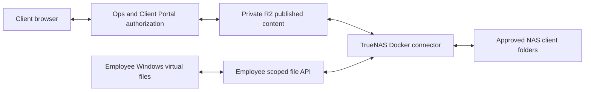

# NAS and R2 bidirectional files: proposed replacement

Status: source-only design, October 26, 2026 (America/Chicago). No container,
bucket, access grant, endpoint or existing synchronization task was changed.
This supersedes treating the read-only Company-files Windows pilot as the final
employee synchronization architecture. It does not activate this proposal.

## Required behavior

Clients authenticate through Operations/Client Portal and read or upload approved
content in private R2 without contacting the NAS. Already-published client data
and the cloud upload path remain usable when the NAS is offline. A TrueNAS SCALE
Docker connector reconciles approved NAS subtrees with their mapped R2 content in
both directions. Employees receive server-enforced access to all or selected
client folders; Windows virtual files remain the requested desktop experience.
Whether normal SMB access is also required is awaiting the owner's clarification.

Employee API placement and protocol are still to be frozen with the Operations
owner. The diagram is a logical flow, not a new inbound NAS port or deployment
instruction. NAS-dependent employee operations may pause during an outage;
employee cloud fallback is a separate product choice. No bucket-wide credentials
are distributed to employee or client devices.

## What exists today

* `docs/truenas/README.md` specifies NAS-authoritative COPY followed by explicitly
  admitted SYNC for server-owned prefixes. It explicitly forbids bidirectional
  operation. A reverse job against the same prefixes would violate that contract.
* `apps/ops-sync` handles business events/projections; it is not this file engine.
* `apps/operations/src/worker/file-events.ts`, `delivery-index-acceptance.ts` and
  `delivery-change-receipts.ts` provide useful event, revision and reconciliation
  components. Their index fences are not a NAS replication journal or body archive.
* `r2-crud.ts` supplies authorized upload sessions, destination baselines and
  conditional publication, plus bounded replacement recovery. Existing recovery
  is not a complete historical version policy for synchronization.
* Employee read provisioning/authority and `docs/employee-read-gateway-protocol.md`
  support exact-root read admission. They do not supply per-client write grants or
  a general NAS write API. Existing broad Operations permissions must not be
  mistaken for the proposed all-clients/selected-clients synchronization grants.
* Portal request attachments use an opaque `_ltds/quarantine/request-attachments`
  workflow. Incoming quarantine/ready pickup is another distinct workflow.
  Neither is an approved general mirror of the published client tree.

The current Windows pilot is download-only. Local edits and added files are not
uploaded by that pilot. Its working sign-in/download tests do not prove this new
two-way design, nor the missing Explorer menu/status behavior.

## Proposed synchronization contract

1. Operations owns stable client/folder identifiers and explicit mappings to a
   fixed NAS subtree and R2 namespace. Access checks apply to list, read, upload,
   rename, delete and restore, not just which folders the UI displays. SMB, if
   requested, requires corresponding NAS ACL enforcement. "All clients" means
   the union of explicitly mapped published client folders, never the entire
   bucket. HR, private application data, quarantine and unrelated sibling prefixes
   remain excluded even for all-client access.
2. The connector keeps a durable local journal, mount identity, scan checkpoints,
   transfer checkpoints and acknowledged remote revisions. An unavailable mount,
   partial scan, permission error or outage never becomes evidence of deletion.
3. Each change carries a stable operation ID, origin and observed base revision.
   Freeze a logical file ID and the exact NAS/R2 base-version pair in the protocol;
   an index revision alone is not a retained copy of the object's earlier body.
   Duplicate notifications and retries are idempotent. Notifications trigger
   reconciliation against current state; they do not establish authoritative
   ordering. Checkpoints advance only after confirmed publication/local commit.
4. Uploads publish conditionally against the observed remote revision. Downloads
   use a temporary file and verified complete bytes before a durable local rename;
   immediately before replacement the connector rechecks that local content has
   not changed. A new edit at either boundary retains both revisions as a conflict
   rather than silently choosing a timestamp winner.
5. Proposed initial conflict policy: preserve both contents and surface a conflict
   for an authorized employee. Keep an explicit revision archive/reference so a
   crash between object storage and metadata commit is reconcilable. Exact
   retention duration and storage budget remain to be decided before activation.
   Explicitly test successful R2 publication followed by failed metadata commit:
   recovery reconciles that original operation and never blindly republishes.
6. Deletion is an explicit authorized tombstone with a revision and recoverable
   retention, not an absent listing entry. An edit versus deletion is a conflict.
   Cross-folder moves recheck both scopes; a failed/partial move cannot silently
   delete its source. Full rename/delete propagation follows copy/update safety
   acceptance rather than being enabled in the first pilot.
7. Normalize and validate paths at every boundary. Ignore exact case-insensitive
   segments `dump`; retain existing reserved `.previews` and `_ltds` handling.
   `dumpster` is not `dump`. `unedited` is an ordinary shareable folder name, not
   a bypass for a path that still contains `dump` or a reserved segment. Reject
   traversal, foreign links and incompatible/colliding Windows path names.
8. Removing a grant stops new operations and invalidates stale authority. Do not
   promise to erase already-downloaded files from an employee's device.

Cloudflare documents R2 as strongly consistent, with concurrent unconditional
writes to one key resolved by the last completed writer. Conditional publication
and application conflict handling are therefore necessary:
<https://developers.cloudflare.com/r2/reference/consistency/>.
Queues may deliver a message more than once; deduplication belongs in the engine:
<https://developers.cloudflare.com/queues/reference/delivery-guarantees/>.

## Transition and acceptance

Before any live migration, inventory the actual existing TrueNAS tasks, namespace
ownership, exclusions, backup/recovery and mappings. Source documentation is not
proof of live configuration. Stop or exclude the old destructive mirror for each
newly managed prefix before enabling bidirectional ownership. Never run opposing
destructive mirrors. This needs a reviewed cutover plan and the owner's separately
authorized TrueNAS action; no NAS management action is part of this source review.

Start with isolated synthetic trees and a fake object store: additions both ways,
simultaneous edits, duplicate/out-of-order events, interrupted transfers, crash at
each journal boundary, missing mount, incomplete scan, revocation and path rules.
Then qualify one approved staging mapping with copy/update only: portal upload
appears on NAS, employee edit appears in R2 and on another admitted device, and a
NAS outage leaves published client reads/cloud uploads working. Prove restart and
conflict recovery before adding rename/delete propagation and wider scopes.
Include an existing public share and an existing authorized download in outage
and cutover acceptance, preserving their current access and bytes; a newly created
synthetic share alone cannot establish compatibility of existing client access.

Windows acceptance remains separate: Explorer status and pin/free verbs, owned
legacy-preview removal with all local content preserved, install Finish/start,
startup/reconnect, and an actual staged installer upgrade. Publish a new shared
installer only when its specific implemented scope and remaining limits are clear.

## Ownership and next implementation boundary

The Windows chat owns desktop lifecycle/installer and legacy-preview cleanup.
PA-Ops Integration owns the Operations/Client publication and authority contract.
The NAS connector's new journal/write contract must be agreed between them before
either side implements live mutation. Existing unrelated quarantine/processing
workflows retain their ownership. No current catalog, feed or source-discovery
activation is implied by this document.
